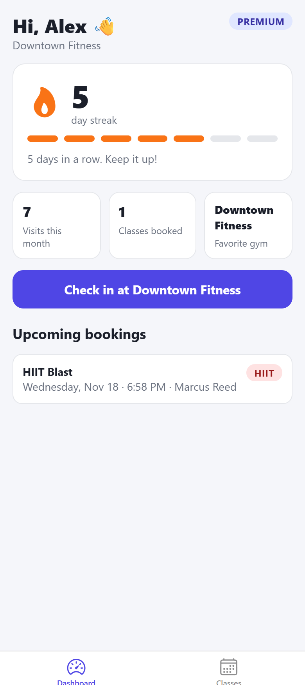
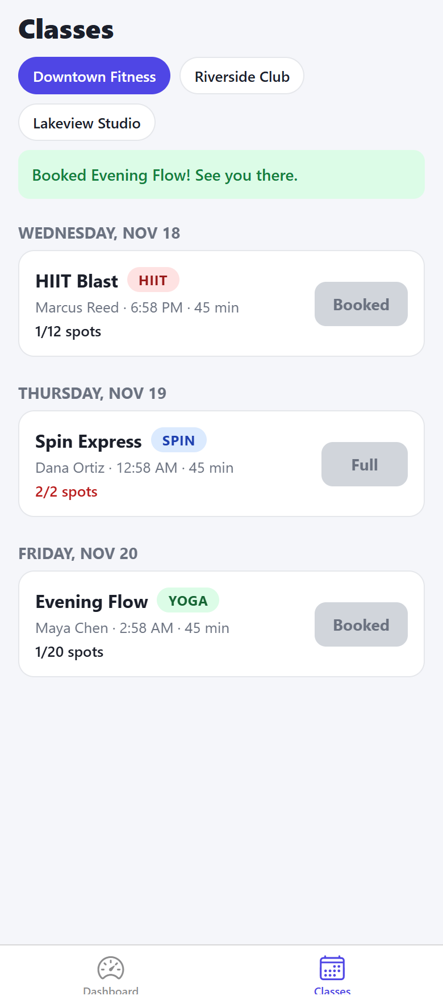
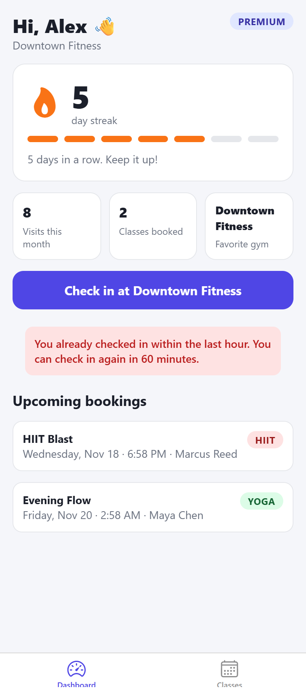

# Member Fitness Dashboard

A simplified member dashboard for a multi-gym chain: view activity, book classes, check in, and track a workout streak.

- `backend/` — Fastify 5 + TypeScript API, in-memory store, Zod validation
- `mobile/` — Expo (SDK 58) + React Native app, Expo Router, TanStack Query

## Screenshots

<p>
  
  
  
</p>

*Dashboard · Class booking (after booking a class; full and already-booked classes are disabled) · A second check-in within the hour is rejected.* Captured from the web build at phone size; the native apps use the same components.

## Setup

Requires Node 20+ (developed on Node 24).

```bash
# 1. API  (http://localhost:3000)
cd backend
npm install
npm start

# 2. App  (in a second terminal)
cd mobile
npm install
npm start          # then press a (Android), i (iOS), w (web), or scan the QR with Expo Go
```

The app finds the API automatically: the machine running Metro (so a phone on the same Wi-Fi works), `10.0.2.2` on the Android emulator, `localhost` otherwise. Override with `EXPO_PUBLIC_API_URL=http://<host>:3000`. The API port is set with `PORT`.

There is no login: the app acts as the seeded member `member-1` (Alex Johnson). Seed data (3 gyms, 5 members, 10 classes) is created at startup relative to the current time, so there are always future classes to book. Data resets when the API restarts.

```bash
npm test          # in backend/ (Vitest) and in mobile/ (Jest + React Native Testing Library)
npm run typecheck # in both
```

## API

Base path `/api`. All bodies are JSON; dates are ISO 8601 UTC.

### Errors

Every error has one shape:

```json
{ "error": { "code": "CLASS_FULL", "message": "This class is full" } }
```

| Status | Used for | Codes |
| --- | --- | --- |
| 400 | Invalid input, class already started | `VALIDATION_ERROR` (adds `details: [{path, message}]`), `CLASS_IN_PAST`, `BAD_REQUEST` (e.g. malformed JSON) |
| 404 | Unknown member, gym, class, booking or route | `NOT_FOUND` |
| 409 | State conflicts | `ALREADY_BOOKED`, `CLASS_FULL`, `DUPLICATE_CHECK_IN` |
| 500 | Unexpected | `INTERNAL_ERROR` (no internals leaked) |

### Members

| Method | Path | Notes |
| --- | --- | --- |
| GET | `/members/:id` | Profile |
| GET | `/members/:id/stats` | Statistics |
| PUT | `/members/:id/preferences` | Body `{ preferredGymId?, notifications?: { classReminders, streakAlerts } }` (at least one field; unknown fields rejected) |
| GET | `/members/:id/bookings` | Upcoming bookings, soonest first |
| GET | `/members/:id/check-ins` | Last 30 days, newest first, plus `streak` |

`GET /members/member-1`

```json
{
  "id": "member-1", "name": "Alex Johnson", "email": "alex@example.com",
  "tier": "premium", "homeGymId": "gym-1", "preferredGymId": "gym-1",
  "joinedAt": "2023-03-14T00:00:00.000Z",
  "notifications": { "classReminders": true, "streakAlerts": true },
  "homeGym": { "id": "gym-1", "name": "Downtown Fitness", "city": "Chicago" },
  "preferredGym": { "id": "gym-1", "name": "Downtown Fitness", "city": "Chicago" }
}
```

`GET /members/member-1/stats`

```json
{
  "totalVisits": 7, "visitsThisMonth": 7, "currentStreak": 5,
  "favoriteGym": { "id": "gym-1", "name": "Downtown Fitness", "city": "Chicago" },
  "classesAttended": 1, "upcomingBookings": 1
}
```

`visitsThisMonth` and `upcomingBookings` are additions the dashboard needs ("visits this month", "classes booked").

### Classes

| Method | Path | Notes |
| --- | --- | --- |
| GET | `/gyms` | Not in the brief; the app needs it for the gym picker |
| GET | `/gyms/:gymId/classes?date=YYYY-MM-DD&type=yoga\|hiit\|spin` | Both filters optional; `date` is matched in UTC |
| POST | `/classes/:classId/book` | Body `{ "memberId": "member-1" }` → `201` |
| DELETE | `/classes/:classId/book/:memberId` | `204`; `404` if there is no such booking |

`POST /classes/class-4/book` → `201`

```json
{
  "booking": { "classId": "class-4", "memberId": "member-3", "bookedAt": "2026-03-18T12:00:00.000Z" },
  "class": { "id": "class-4", "gymId": "gym-1", "name": "Evening Flow", "instructor": "Maya Chen", "type": "yoga",
             "startsAt": "2026-03-20T16:00:00.000Z", "durationMinutes": 45, "capacity": 20,
             "booked": 1, "spotsLeft": 19, "isFull": false }
}
```

Booking checks, in order: class and member exist (404) → class has not started (400 `CLASS_IN_PAST`) → not already booked (409 `ALREADY_BOOKED`) → space left (409 `CLASS_FULL`).

### Check-ins

`POST /check-in` body `{ "memberId": "member-1", "gymId": "gym-1" }` → `201`

```json
{ "checkIn": { "id": "checkin-16", "memberId": "member-1", "gymId": "gym-1", "at": "2026-03-18T12:00:00.000Z" }, "streak": 5 }
```

A second check-in by the same member within one hour (at any gym) is `409 DUPLICATE_CHECK_IN`; the message says when they can check in again.

`GET /members/:id/check-ins` → `{ "checkIns": [ ... ], "streak": 5 }`

## Architecture and trade-offs

**Backend layers.** `routes/` (HTTP + schemas only) → `services/` (all business rules, no Fastify types) → `store/` (typed in-memory Maps/arrays + seed). `buildApp({ store, clock })` takes both as arguments, so tests use a fixed clock and a fresh store, and the whole API is exercised with `fastify.inject`.

**Zod via `fastify-type-provider-zod`.** One schema gives runtime validation and the TypeScript types for `params`, `query` and `body`, so there are no hand-written duplicates and no `any`. One error handler turns validation failures, domain errors (`AppError` subclasses) and Fastify's own 4xx into the single error shape above.

**Streak definition** (`services/streak.ts`, pure function). The streak is the number of consecutive UTC calendar days, ending today, with at least one check-in; several visits in a day count once. If there is no visit yet today but there was one yesterday, the streak is still alive, because the member still has today to extend it; two missed days break it. Trade-off: days are UTC, not the member's local day, so someone checking in near local midnight can land on the "wrong" day. A real system would store a time zone per gym or member.

**Check-in duplicate window.** Per member across all gyms, not per gym, since one person cannot be at two gyms within an hour.

**Concurrency.** The store is synchronous and Node is single-threaded, so check-then-write in `book` and `checkIn` cannot interleave. With a real database this would need a transaction or a unique constraint plus a capacity check.

**Favorite gym** is the most visited; ties go to the home gym, then the lowest id.

**Mobile.** Expo Router (two tabs) for navigation; TanStack Query for server state, which provides loading, error, retry and pull-to-refresh without hand-written plumbing. Mutations refetch classes, bookings and stats afterwards, including after a failure, so a "class is full" error also corrects a stale screen. Screens in `src/screens`, small presentational components in `src/components`, and a single typed fetch client in `src/api` (`ApiError` carries the server's `code`/`message`, which the UI shows).

**Not built (out of scope):** authentication (the app is fixed to `member-1`), persistence, cancelling a booking from the app (the endpoint exists), a UI for editing preferences (the endpoint exists), pagination.

## Tests

- Backend (`backend/test/api.test.ts`, 13 tests): streak calculation (service); endpoints via `fastify.inject`; validation and conflict edge cases (duplicate check-in with a controllable clock, duplicate/full/past bookings, bad query values, malformed JSON).
- Mobile (`mobile/__tests__/ClassCard.test.tsx`, 5 tests): `ClassCard` renders capacity/type and its Book button is disabled when full or already booked; classes that have started are hidden; class grouping by date.
